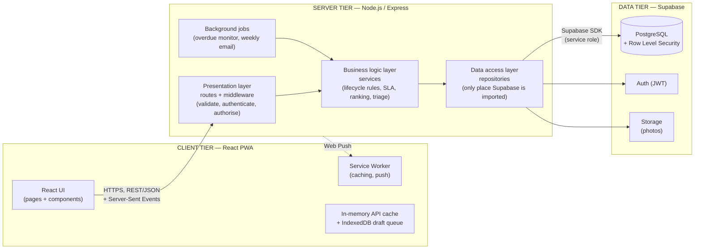
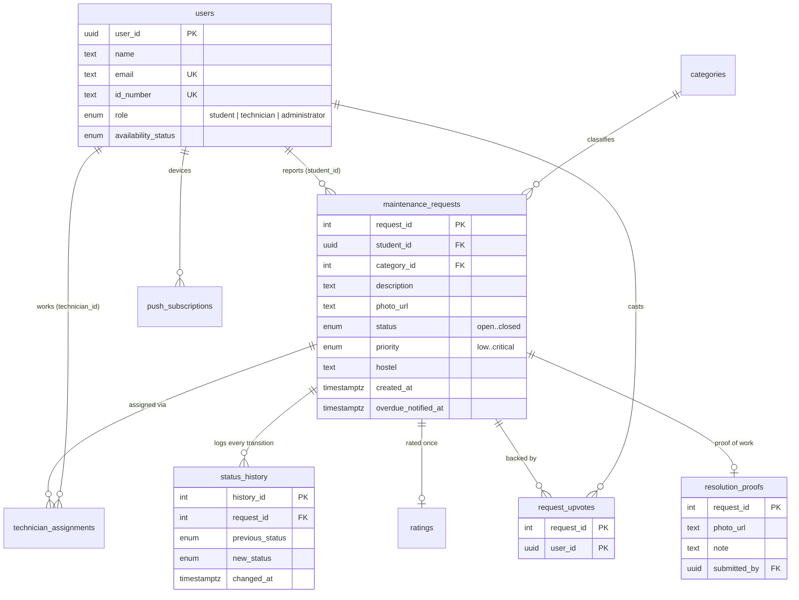
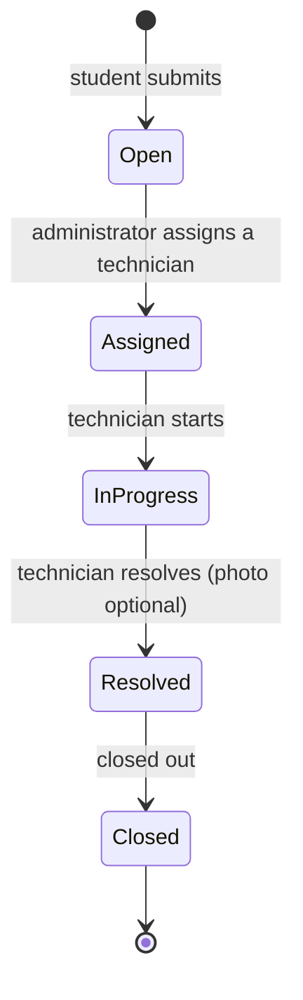
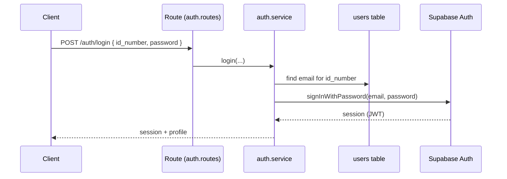

# Architecture

Hostel Maintenance Request and Tracking System — University of Zambia.
A Progressive Web App (PWA) where students report hostel faults, administrators
triage and assign them, and technicians resolve them, with the whole lifecycle
tracked and analysed.

This document explains *how the system is built and why*. Diagrams use
[Mermaid](https://mermaid.js.org/), which GitHub renders automatically.

---

## 1. The big picture

**Client–server architecture; the server is internally a three-layer
architecture; the client is a PWA.**



### Two rules that are enforced everywhere

1. **The client never talks to Supabase.** There are no Supabase keys or SDK in
   the front end. Every read and write goes through the Express REST API. This is
   what keeps business rules and access control in one place where they can be
   enforced and tested.
2. **The server's layers only call downward.**
   - *Routes* validate input, authenticate, authorise, call one service, format
     the response. No business logic, no database access.
   - *Services* hold the business rules. They contain no `req`/`res`, so they are
     framework-agnostic and unit-testable in isolation.
   - *Repositories* are the only files that import the Supabase client. They
     query and map rows; no business logic.

> Why this matters: the layer boundary is what made every feature in this
> project small to add and safe to test. For example the SLA rule
> (`server/src/utils/sla.js`) is a pure function used by the API, the overdue
> monitor and the weekly email — one definition, three uses, six unit tests.

---

## 2. Technology choices

| Concern | Choice | Why |
|---|---|---|
| UI | React (functional components + hooks) | Component model fits the three role-based UIs; one codebase for phone and desktop |
| Styling | Plain CSS, one file per component, design tokens as CSS variables | No build-time dependency; tokens make theming (dark mode) a matter of overriding variables; class names are prefixed per component to avoid global clashes |
| Server | Node.js + Express | Same language end-to-end; Express middleware maps directly onto the presentation layer |
| Database | Supabase (PostgreSQL) | Relational integrity (foreign keys), Row Level Security, managed Auth and Storage |
| Auth | Supabase Auth (JWT), verified on the server | Password handling is not hand-rolled |
| PWA | Service worker + Web App Manifest | Installable, resilient to poor connectivity, receives push notifications |
| Charts | Recharts (the only charting library) | Animated, accessible charts; loaded only for administrators |
| Push | Web Push (VAPID) via `web-push` | Standards-based, no third-party push service |
| Email | SMTP via `nodemailer` | Works with any provider (Gmail app password is enough) |
| AI (optional) | Anthropic Claude via the official SDK | Category/priority suggestions; the app works without it |

Everything is JavaScript, on purpose: one language for students of the codebase.

---

## 3. Folder structure

```
client/                      React PWA
  public/                    manifest.json, service-worker.js, icons
  src/
    pages/                   one folder per screen (.jsx + .css)
    components/              shared UI (StatCard, SlaBadge, charts, ...)
    services/                API wrappers, cache, offline draft queue, push, theme
    hooks/                   auth, live updates
    styles/                  variables.css (tokens) + theme.css (dark theme)
    utils/                   formatters, image compression
server/
  server.js                  Express app + scheduler start
  sql/                       numbered migrations 001 ... 012
  src/
    routes/                  presentation layer
    middleware/              authenticate, requireRole, errorHandler
    services/                business logic layer (+ unit tests)
    repositories/            data access layer (only place Supabase is imported)
    jobs/                    background scheduler
    config/                  Supabase, web-push, mail, Anthropic clients
    utils/                   pure helpers (SLA rules, labels)
docs/                        this document, viva guide, screenshots
```

---

## 4. Data model



Design points worth defending:

- **Integrity lives in the database, not only in code.** Foreign keys everywhere;
  `request_upvotes` has a *composite primary key* `(request_id, user_id)` so a
  double vote is impossible even if application code were bypassed; `ratings`
  has a unique `request_id` (one rating per request).
- **Row Level Security is on for every table** as a second line of defence
  (students see only their own rows, technicians only assigned work, administrators
  broader access). The server uses the service role, so RLS matters most if a
  key ever leaked or a client were ever pointed at the database directly.
- **Every status change is recorded** in `status_history`. This is what feeds the
  analytics (average resolution time, throughput) and the timeline users see.
- **Additive migrations.** New features add tables rather than altering hot ones
  (e.g. `resolution_proofs` is its own table), so the app keeps working before a
  migration has been applied.

---

## 5. The ticket lifecycle (a business rule, not a UI rule)



- Strictly linear, one step at a time; skipping (`Open → Closed`) or going
  backward is rejected **by the service layer** with a clear error
  (`requests.service.js → isValidTransition`).
- `Assigned` can only be reached through the assign action, which creates the
  `technician_assignments` row in the same operation — status and assignment
  cannot drift apart.
- A technician can only advance requests **assigned to them**; students only see
  their own; administrators see all. Checked on the server on every request.
- When resolving, a technician can attach a **photo of the finished work** and a
  note (optional; `REQUIRE_RESOLUTION_PROOF=true` makes the photo mandatory for
  technicians). If a photo is sent it is validated and stored *before* the status
  changes, so a failed upload never leaves a request "resolved" with lost proof.

---

## 6. Authentication and access control

**ID-based login, resolved on the server.** Students log in with their student/staff
ID, not their email, but Supabase Auth is email-based underneath:



Every protected route then runs `authenticate` (verifies the JWT and loads the
profile) and `requireRole(...)`. **The UI hiding a button is convenience; the server
check is the security.** Ownership rules (a student may read only their own
request, a technician only assigned ones) live in the services.

Profile lookups are cached for 30 seconds (cleared on profile edits) to remove two
network round trips from most requests.

---

## 7. Real-time behaviour

| Feature | Mechanism |
|---|---|
| Open pages update when a request changes | **Server-Sent Events** (`GET /api/events`). The server pushes only a request id + message; the client refetches through the normal permission-checked API. SSE was chosen over WebSockets/Supabase Realtime because updates only flow server → client and the architecture forbids the client talking to Supabase. |
| Notifications when the app is closed | **Web Push** (VAPID). Sent on new requests, assignments, status changes and overdue alerts. Logging out removes the device's subscription so a shared phone never receives someone else's alerts. |
| Overdue alerts | A background monitor checks every hour; a request past its SLA is alerted once, then reminded while still overdue (every 4 h for critical/high, daily otherwise — `overdue_notified_at` holds the last alert time) — to administrators + the assigned technician. |
| Weekly summary | Monday 06:00 UTC (08:00 Lusaka) email to administrators; last-run stored in `job_runs` so a restart cannot cause a duplicate. |

---

## 8. Offline tolerance and performance (the PWA layer)

- **Installable**: web manifest with PNG + maskable icons, standalone display,
  shortcuts (*Report an issue*, *My requests*). Chrome's installability check
  reports no errors.
- **Service worker strategies**: hashed build assets are cache-first (instant, no
  network); page loads are network-first with a 2.5 s timeout falling back to the
  cached shell; everything else network-first.
- **Offline drafting**: a student can write a request with no connectivity; it is
  stored in IndexedDB (`draftQueue.js`) and submitted automatically when the
  connection returns (`draftSync.js`). Implemented in the page rather than
  Background Sync, because Background Sync is not available on iOS/Firefox.
- **Stale-while-revalidate data cache** (`apiCache.js`): pages render instantly from
  the last data they saw and refresh in the background; the cache is cleared on any
  write and on login/logout so stale or another user's data never shows.
- **Code splitting**: every page is its own chunk. The entry bundle is ≈ 248 kB
  (79 kB gzipped); the 355 kB chart library is downloaded only by administrators.
  Remaining pages are prefetched during idle time.
- **gzip** on API responses; photos are compressed in the browser (max 1600 px,
  JPEG) before upload, turning 4–10 MB phone photos into a few hundred kB.

---

## 9. Feature modules (beyond the core lifecycle)

| Feature | Where it lives | Business rule |
|---|---|---|
| **Upvotes ("Me too")** | `upvotes.service.js` | Can't upvote your own or a resolved request; idempotent; other students' names are never exposed |
| **AI triage** | `triage.service.js` | Claude (schema-constrained JSON) with a keyword-rules fallback; a **safety floor** forces hazards (fire, sparking, flooding) to *critical* regardless of the model; user text is treated as untrusted; per-user rate limit |
| **SLA timers** | `utils/sla.js` | critical 4 h · high 24 h · medium 72 h · low 1 week; *at risk* in the last 25 %; stops when resolved |
| **Smart assignment** | `users.service.js → rankTechnicians` | Available before on-job before off-duty; then fewest active tasks; off-duty is never recommended |
| **Proof of work** | `requests.service.js` | Technicians can attach a photo (and note) when resolving; it is optional by default and can be made mandatory with `REQUIRE_RESOLUTION_PROOF=true` |
| **Hostel heatmap** | `HostelHeatmap.jsx` | Hostel × category counts; answers "where should maintenance go this week?" |
| **Dark mode** | `styles/theme.css` | Overrides colour tokens only, so every component switches automatically |

---

## 10. API surface

All routes are under `/api`. "Scoped" means the service checks ownership as well as role.

| Area | Endpoint | Who |
|---|---|---|
| Auth | `POST /auth/register` | public (students only) |
| | `POST /auth/login` | public |
| | `GET /auth/me` | any signed-in user |
| Requests | `POST /requests` | student |
| | `GET /requests/mine` | student |
| | `GET /requests/community` | student |
| | `POST /requests/triage` | student |
| | `POST /requests/:id/upvote` and `DELETE /requests/:id/upvote` | student |
| | `POST /requests/:id/rating` | student |
| | `GET /requests` | administrator |
| | `POST /requests/:id/assign` | administrator |
| | `PATCH /requests/:id/priority` | administrator |
| | `GET /requests/assigned-to-me` | technician |
| | `GET /requests/:id` | scoped (owner / assigned / admin) |
| | `PATCH /requests/:id/status` | scoped (assigned technician / admin) |
| Users | `GET /users`, `POST /users` | administrator |
| | `GET /users/technicians` | administrator |
| | `GET /users/me`, `PATCH /users/me` | any signed-in user |
| | `PATCH /users/me/availability` | technician |
| Reports | `GET /reports/analytics` | administrator |
| | `POST /reports/digest/send` | administrator |
| Live and push | `GET /events` (Server-Sent Events) | any signed-in user |
| | `GET /push/public-key` | public |
| | `POST /push/subscribe`, `POST /push/unsubscribe` | any signed-in user |
| Misc | `GET /categories`, `GET /activity/recent` | any signed-in user |
| | `GET /health` | public |

---

## 11. Security summary

- HTTPS in deployment; JWT verified on every protected route; passwords never
  handled by the app (Supabase Auth).
- Server-side validation of every input, regardless of client validation.
- Role checks (`requireRole`) **and** ownership checks in services; RLS as a
  second layer.
- No secrets in source control: `.env` is git-ignored, `.env.example` documents
  every variable. No Supabase key exists in the front end.
- Uploads: type allow-list (JPEG/PNG/WebP), 5 MB cap, stored server-side.
- Email templates HTML-escape user-controlled text; AI prompts treat descriptions
  as untrusted data; the AI endpoint is rate-limited.
- Push subscriptions are per user and removed on logout.

---

## 12. Testing

- **158 automated tests** (Vitest): **110 unit tests** covering the business
  rules with repositories mocked, and **48 integration tests** that drive the real
  Express app over HTTP (routes + middleware + services, database faked) — see
  [TESTING.md](TESTING.md). The unit tests cover: lifecycle transitions and role restrictions,
  proof-of-work ordering, SLA states, overdue detection, technician ranking,
  upvote rules and feed ranking, AI-triage safety floor and rate limit, push
  delivery and cleanup, live-event routing, weekly-email statistics/schedule/escaping,
  analytics maths, and the auth/role middleware.
- **Browser verification** (Playwright, headless Chromium) of the front-end flows
  at phone and desktop widths, including the offline path, live updates arriving
  on an open page, the technician proof flow and dark mode.
- **Manual UAT** of the student → administrator → technician flow.
- **Continuous integration** (GitHub Actions, `.github/workflows/ci.yml`): every
  push and pull request runs the unit tests, the integration tests, lint and a
  production build; no secrets are needed.

---

## 13. Known limitations (be upfront about these)

- **Integration tests use a faked database.** They prove the routes → services →
  repositories wiring, access control and error handling, but not Postgres itself
  (SQL, RLS policies and migrations are checked in Supabase and by manual UAT). A
  small suite against a disposable real database is the next step. Front-end browser
  checks are not yet a committed automated suite.
- **Single-instance assumptions.** Live-update connections, the token cache and the
  rate limiter are in memory. Running several server instances would need a shared
  store (e.g. Redis). Fine for this deployment scale.
- **Free-tier hosting** sleeps when idle; a scheduled ping to `/api/health` avoids
  slow first requests.
- **Optional integrations need configuration**: AI needs `ANTHROPIC_API_KEY`, email
  needs SMTP credentials, push needs VAPID keys. Each degrades gracefully when absent.
- **iPhone push** works only after the app is added to the Home Screen.
- Screenshots in `docs/screenshots` are generated from sample data.

## 14. Future work

Realtime chat between student and technician, recurring-issue detection,
preventive-maintenance schedules, multi-campus support, and an SMS fallback for
students without data.
