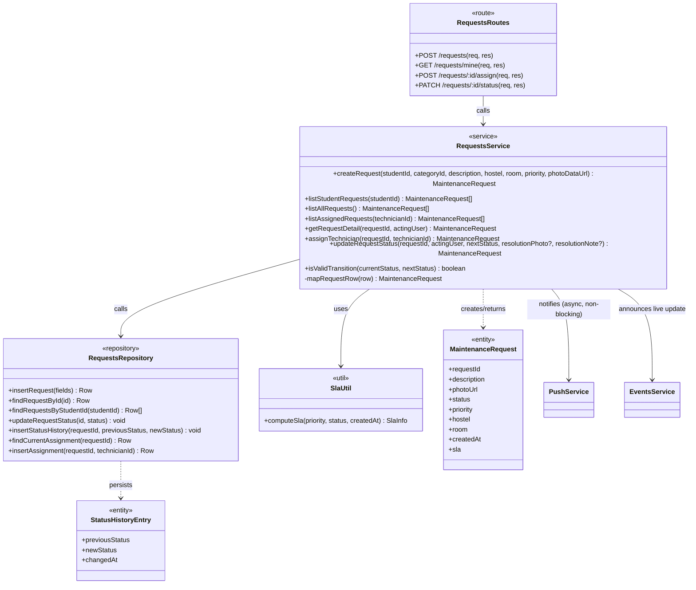
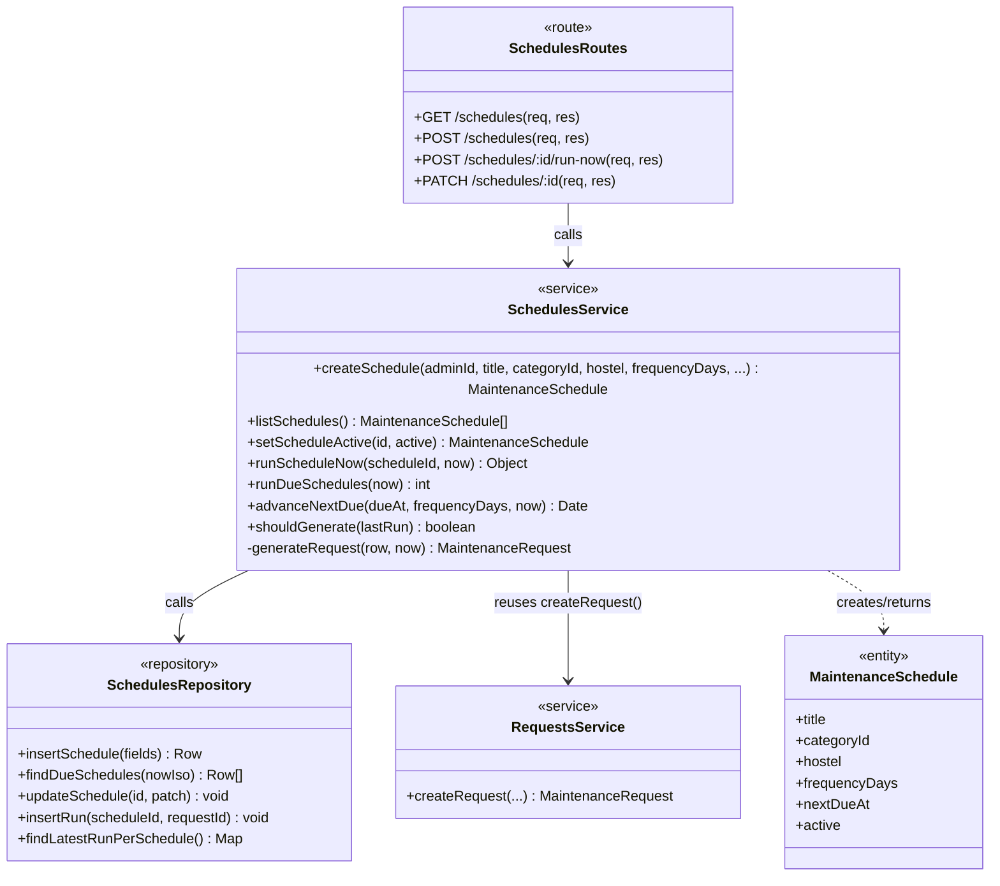
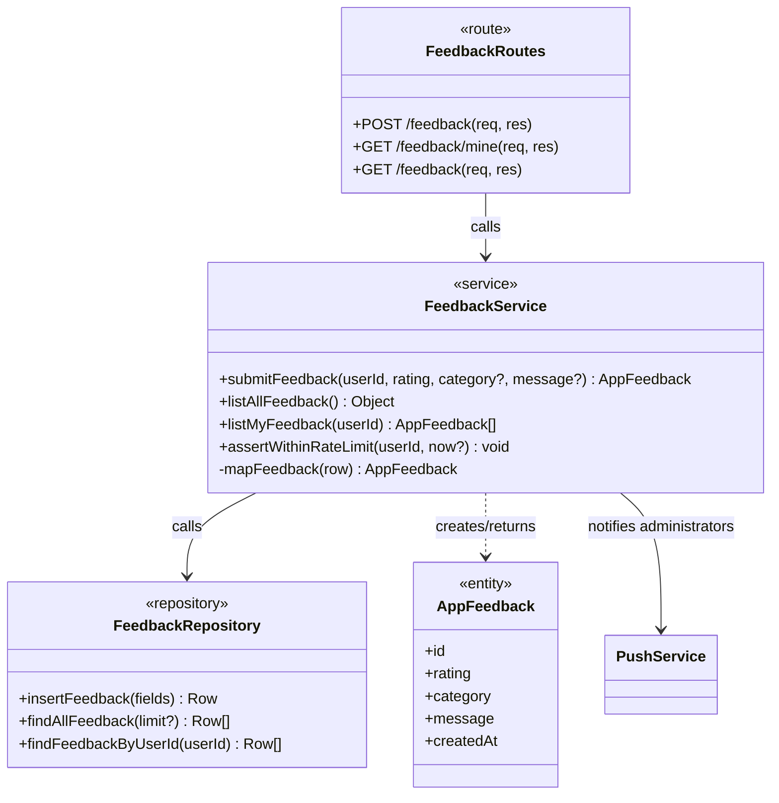

# Design Class Diagram

Elaboration Iteration 2 deliverable (UP): the **design model**, refined from
[DOMAIN_MODEL.md](DOMAIN_MODEL.md) by adding **methods** — this is where a
concept becomes something with real, callable behaviour. This document maps
directly onto the actual server code (`server/src/services`,
`server/src/repositories`), not an idealised version of it — every method
named below is a real exported function.

**A note on notation.** The codebase is written as ES modules of exported
functions (`export function createRequest(...) {...}`), not as JavaScript
`class` syntax — a deliberate style choice (framework-agnostic, easily
unit-tested services with no `this`, see
[LOGICAL_ARCHITECTURE.md §2](LOGICAL_ARCHITECTURE.md#2-the-four-logical-layers)).
Each module is nonetheless a cohesive design **class** in the UML sense — a
named unit with state (module-level, where it has any, e.g. an in-memory
rate-limit map) and behaviour (its exported functions) — and is drawn as one
here, stereotyped by layer, with its exported functions as methods.

---

## 1. Request lifecycle subsystem (the core)

- `RequestsService.isValidTransition` is the single, unit-tested source of
  truth for the lifecycle rule in
  [ARCHITECTURE.md §5](ARCHITECTURE.md#5-the-ticket-lifecycle-a-business-rule-not-a-ui-rule) —
  it is a private method (`-`) because nothing outside this service should
  ever need to ask it directly; every caller goes through `updateRequestStatus`.
- `MaintenanceRequest.sla` is not a stored column — it is computed on every
  read by `SlaUtil.computeSla`, which is why it is shown as part of the DTO
  returned to callers but not of `RequestsRepository`'s persisted row.

## 2. Preventive maintenance subsystem

`SchedulesService` deliberately **depends on** `RequestsService` rather than
duplicating request-creation logic — the one cross-subsystem dependency in
the whole design that is not routes → services → repositories, and it is
drawn here explicitly because it is exactly the kind of dependency
[LOGICAL_ARCHITECTURE.md §3](LOGICAL_ARCHITECTURE.md#3-package-diagram--business-capabilities)
calls out: Preventive Maintenance depends on Request Lifecycle, never the
reverse.

## 3. App feedback subsystem (smallest complete example)

This subsystem is included in full precisely *because* it is the smallest —
it demonstrates the three-layer pattern holds even for the newest, simplest
feature, with nothing hidden or special-cased.

---

## 4. Every other service — responsibility and key methods

The remaining services follow the identical `Routes → Service →
Repository` shape shown above; listing each one's full method signatures
would repeat the same pattern seventeen more times without adding new
design information. Their distinct **responsibilities** are what matters,
and are captured in table form (identical content to
[TECHNICAL_DOCUMENTATION.md §6.1](TECHNICAL_DOCUMENTATION.md#61-layers-and-module-map),
repeated here because a design class diagram document should be readable on
its own without cross-referencing another document for the class list):

| Service (design class) | Key methods | Depends on |
|---|---|---|
| `AuthService` | `registerStudent`, `login`, `verifyToken` | `UsersRepository`, Supabase Auth |
| `UpvotesService` | `addUpvote`, `removeUpvote`, `rankCommunityRequests` | `UpvotesRepository`, `RequestsRepository` |
| `TriageService` | `suggestTriage`, `applySafetyFloor` | Anthropic client, `RateLimiter` (in-memory) |
| `UsersService` | `rankTechnicians`, `setAvailability`, `updateProfile` | `UsersRepository` |
| `ReportsService` | `getAnalytics` | `ReportsRepository` |
| `OverdueService` | `findRequestsDueForAlert`, `runOverdueCheck` | `RequestsRepository`, `SlaUtil`, `PushService` |
| `DigestService` | `buildWeeklyStats`, `sendWeeklyDigest` | `ReportsRepository`, mailer client |
| `PushService` | `subscribe`, `notifyUser`, `notifyUsers`, `notifyAdministrators` | `PushRepository`, web-push client |
| `EventsService` | `announceRequestChange`, `subscribe` (SSE) | in-memory connection registry |
| `AnnouncementsService` | `createAnnouncement`, `listForUser`, `selectForStudent`, `selectForTechnician`, `resolveRecipients` | `AnnouncementsRepository`, `UsersRepository`, `RequestsRepository` |
| `CommentsService` | `addComment`, `listComments`, `loadConversation` | `CommentsRepository`, `RequestsRepository` |
| `RecurrenceService` | `detectRecurringIssues`, `normalizeRoom` | `ReportsRepository` |
| `PerformanceService` | `computeTechnicianPerformance`, `getMyPerformance` | `ReportsRepository` |
| `RatingsService` | `submitRating` | `RatingsRepository` |
| `CategoriesService` | `listCategories` | `CategoriesRepository` |
| `ActivityService` | `getRecentActivity` | `ActivityRepository` |

Every method in every table above is `+` public (called from a route or
from another service) except where marked `-` (an internal helper, called
only within its own module) — the same visibility convention used in §1–3.
