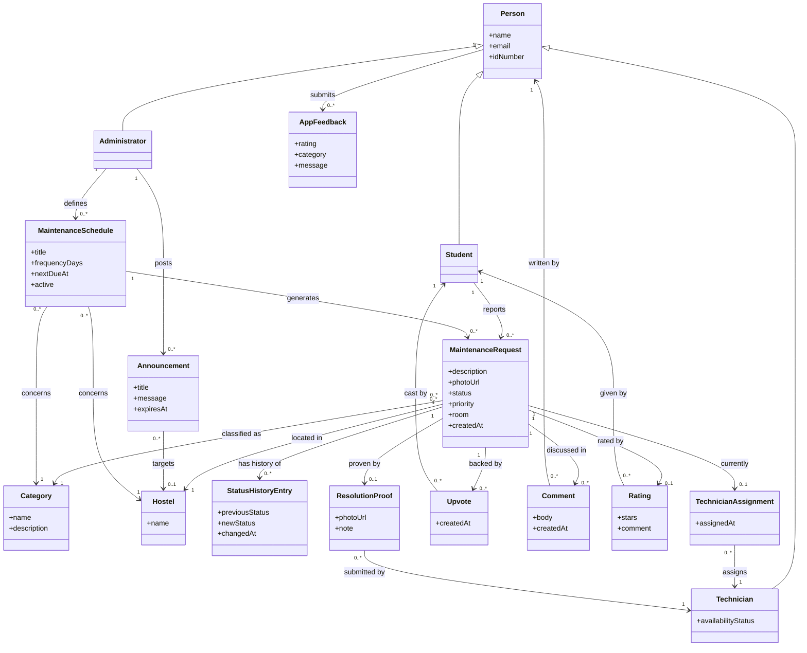

# Domain Model

Elaboration Iteration 1 deliverable (UP): the **conceptual class diagram** —
real-world concepts a stakeholder (a hostel warden, a technician, a student)
would recognise and name, with their attributes and the associations between
them. This is deliberately **not** the database schema: a domain model shows
*concepts*, not tables, and concepts do not always map one-to-one onto a
table (see §3). The database schema — the physical realisation of this same
domain — is in [ARCHITECTURE.md §4](ARCHITECTURE.md#4-data-model); the
**design** classes that implement these concepts in code (with methods) are
in [DESIGN_CLASS_DIAGRAM.md](DESIGN_CLASS_DIAGRAM.md).

---

## 1. Conceptual class diagram

---

## 2. Concept definitions

| Concept | Definition | Real-world example |
|---|---|---|
| **Person** | Anyone with an account in the system. An abstract concept — every real person is exactly one of the three specialisations below, never a bare Person. | — |
| **Student** | A hostel resident who reports faults. | "Samson Mwale, 2022052195" |
| **Technician** | Maintenance staff who resolve assigned faults. | "John Mwembe, available" |
| **Administrator** | Estates & Maintenance staff who triage, assign and analyse. | "Dr. Mwamba" |
| **MaintenanceRequest** | One reported fault, from submission to closure — the central concept of the whole domain. | "Tap in Block C bathroom leaks" |
| **Category** | The kind of fault, used for classification and analytics. | "Plumbing", "Electrical", "Furniture" |
| **Hostel** | A residence building — a location concept the domain clearly has, even though (see §3) it is not its own table physically. | "Kalingalinga", "Africa Block 3" |
| **StatusHistoryEntry** | One recorded transition in a request's lifecycle — what makes the timeline and the analytics possible. | "assigned → in_progress at 14:02" |
| **TechnicianAssignment** | The fact that a specific technician is responsible for a specific request, from when it was assigned. | — |
| **Upvote** | A student's endorsement of an existing report ("this affects me too"), instead of filing a duplicate. | — |
| **Comment** | One message in the conversation about a request, visible only to its three participants. | "Which tap is it?" |
| **Rating** | A student's 1–5 star judgement of how a specific repair was handled, given once, after resolution. | ★★★★★ "Fixed quickly" |
| **ResolutionProof** | The technician's evidence a repair was actually completed. | a photo + "Replaced the washer" |
| **Announcement** | A notice from an administrator to some or all students. | "Water cut in Block C, 10:00–12:00" |
| **MaintenanceSchedule** | A recurring preventive check an administrator has defined, independent of any single fault being reported. | "Inspect geysers, monthly" |
| **AppFeedback** | A review of the application itself, not of any one repair. | ★★★★☆ "Would love a dark mode toggle" |

## 3. Where the domain model and the database schema deliberately diverge

A domain model captures concepts; the database captures whatever
representation is cheapest and safest to store and query. Three places in
this project where the two intentionally differ, and why:

- **Hostel is a first-class concept here, but free text in the database.**
  The domain clearly has a "Hostel" concept — students live in one,
  requests happen in one, announcements target one. Physically, though,
  `maintenance_requests.hostel` and `users.hostel` are plain `text` columns
  backed by a client-side list (`client/src/utils/requestFormat.js`), not a
  foreign key to a `hostels` table. This was a deliberate scope decision
  (see `007_add_priority_location_ratings_availability.sql`'s own comment:
  *"no fixed hostel table exists elsewhere in this schema, and adding one is
  out of scope"*) — the domain concept exists and is documented, but was not
  judged worth a physical table for this project's needs.
- **Person is one table with a role, not three.** The domain model shows
  Student/Technician/Administrator as a clean UML generalisation because
  that is how a stakeholder thinks about them — three different kinds of
  person with different permissions. Physically they are one `users` table
  with a `role` enum column (`student` | `technician` | `administrator`),
  because the three "subtypes" share every attribute and only differ in
  behaviour, which the business logic layer (not the schema) is the right
  place to encode — see [LOGICAL_ARCHITECTURE.md §2](LOGICAL_ARCHITECTURE.md#2-the-four-logical-layers).
- **A MaintenanceSchedule "generates" requests, but there is also a join
  table.** The domain model shows a direct association
  (`MaintenanceSchedule → MaintenanceRequest`) because that is the concept;
  physically, `maintenance_schedule_runs` sits between them, recording
  *which* request each run of the schedule produced — needed so the system
  can check "is the previous one still open?" before generating another,
  a rule with no equivalent concept a stakeholder would think to name, but
  essential to the implementation (see UC-38 in [USE_CASES.md](USE_CASES.md)).
