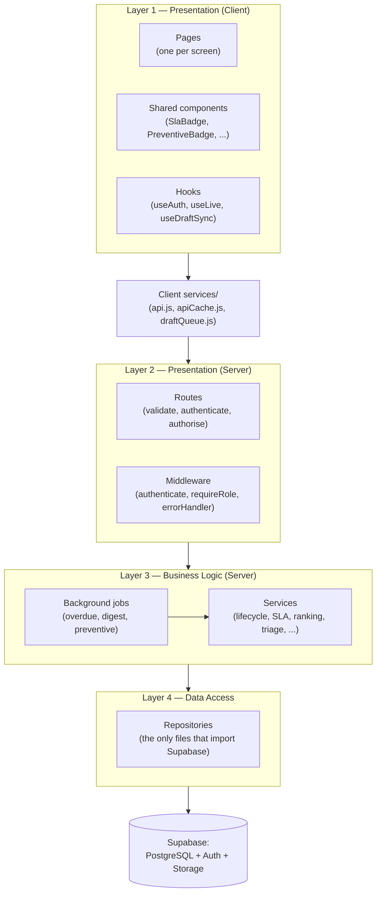
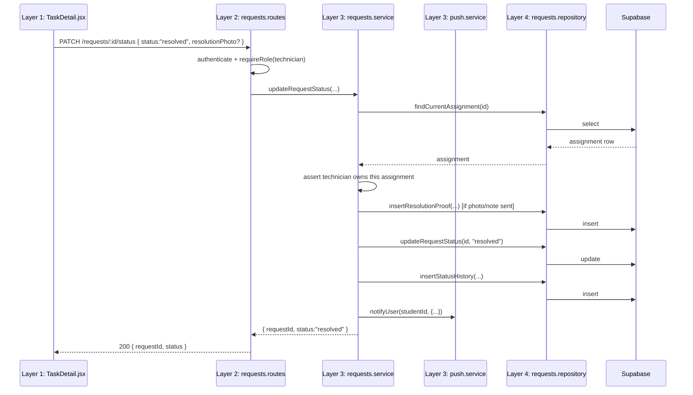

# Logical Architecture

Companion to [ARCHITECTURE.md](ARCHITECTURE.md) (the big picture and design
rationale) and [PHYSICAL_ARCHITECTURE.md](PHYSICAL_ARCHITECTURE.md) (where
things actually run). This document is the **logical view**: how the system
is decomposed into layers, packages and subsystems, what each one is
responsible for, and — critically — which ones are *allowed* to depend on
which. It answers "how is the software structured?", independent of which
machine anything runs on.

---

## 1. Why a separate logical view

A system's **logical architecture** groups its software into layers and
packages by responsibility, and fixes the allowed dependencies between them.
A system's **physical architecture** (see the companion document) maps that
software onto real machines, processes and networks. The two are
deliberately different views of the same system: two client-server
deployments can share an identical logical architecture while looking
nothing alike physically (a single Render dyno vs. a cluster, for example),
and the reverse also holds. Keeping them apart is itself a design decision
that this project follows: CLAUDE.md's layering rules (routes → services →
repositories, "layers only call downward") are a *logical* constraint,
enforced in code, and hold regardless of how many servers the physical
deployment eventually uses.

---

## 2. The four logical layers

**The one rule that defines this architecture**: an arrow only ever points
*down*. A page never imports a repository; a route never runs a SQL query; a
service never reads `req`/`res`. This is not a convention that happens to be
followed — it is mechanically true of the code, because:

- **Services take plain arguments and return plain objects/throw
  `httpError`s** — no Express types cross the boundary — which is what makes
  every service unit-testable with the repository mocked and no HTTP
  involved (`server/src/services/*.test.js`).
- **Only `repositories/*.js` import `../config/supabaseClient.js`.** Nothing
  else in the server can reach the database, even by accident — a grep for
  `from '.*supabaseClient'` outside `repositories/` returns nothing.
- **The client has no Supabase client or key at all.** Every read and write,
  for every role, goes through the Express REST API (`client/src/services/api.js`),
  which is the client-side counterpart of the same rule — see
  [ARCHITECTURE.md §1](ARCHITECTURE.md#1-the-big-picture).

| Layer | Package(s) | Responsibility | May depend on |
|---|---|---|---|
| 1. Presentation (client) | `client/src/pages`, `client/src/components`, `client/src/hooks` | Render the three role-based UIs; local UI state only | Client services layer |
| — client services | `client/src/services` | HTTP calls to the API, response caching, the offline draft queue, push subscription, theme | Nothing below it (talks over HTTP only) |
| 2. Presentation (server) | `server/src/routes`, `server/src/middleware` | Parse/validate the request, authenticate, authorise, call **one** service, shape the HTTP response | Layer 3 only |
| 3. Business logic | `server/src/services`, `server/src/jobs` | Every business rule: the ticket lifecycle, SLA maths, technician ranking, AI-triage safety floor, recurring-issue detection, preventive scheduling, rate limits | Layer 4 only |
| 4. Data access | `server/src/repositories` | Query Supabase and map rows ⇄ plain objects; no business rules | Supabase only |

Two supporting packages sit beside the layers rather than inside them,
because they are used *by* every layer rather than belonging to one:

- **`server/src/utils`** — pure, side-effect-free helpers with no layer of
  their own (`sla.js`, `preventive.js`, `httpError.js`). `sla.js` is the
  clearest example of why this matters: it is imported by `requests.service.js`,
  `overdue.service.js`, `digest.service.js` **and** `performance.service.js` — one
  definition of "how late is late", used and tested once, not reimplemented
  four times.
- **`server/src/config`** — environment and third-party client setup
  (Supabase, web-push, mailer, Anthropic). Imported by whichever layer needs
  a given client (mostly layer 4, plus `push.service.js` for delivery).

---

## 3. Package diagram — business capabilities

Layers describe *how* code is organised top-to-bottom; this view describes
*what* it is organised **into** — the business-capability packages inside
the business logic layer, and the tables in the data layer each one owns.
This is closer to what Larman calls the *design model*: less about the four
generic layers, more about the actual subsystems a maintainer would name.

```mermaid
flowchart LR
  subgraph Auth["Auth & Identity"]
    authS["auth.service"]
    usersS["users.service"]
  end
  subgraph Lifecycle["Request Lifecycle"]
    requestsS["requests.service"]
    triageS["triage.service"]
    upvotesS["upvotes.service"]
    commentsS["comments.service"]
  end
  subgraph Ops["Operations & SLA"]
    overdueS["overdue.service"]
    digestS["digest.service"]
    reportsS["reports.service"]
    performanceS["performance.service"]
    recurrenceS["recurrence.service"]
  end
  subgraph Comms["Communication"]
    announcementsS["announcements.service"]
    pushS["push.service"]
    eventsS["events.service"]
    feedbackS["feedback.service"]
  end
  subgraph Preventive["Preventive Maintenance"]
    schedulesS["schedules.service"]
  end

  Lifecycle --> Auth
  Ops --> Lifecycle
  Preventive --> Lifecycle
  Comms --> Auth
  Lifecycle --> Comms
  Preventive --> Comms
```

- **Auth & Identity** owns `users`. Every other package depends on it for
  "who is this and what role do they have", never the reverse.
- **Request Lifecycle** owns `maintenance_requests`, `status_history`,
  `request_upvotes`, `request_comments`, `ratings`, `resolution_proofs` — the
  core of the system.
- **Preventive Maintenance** owns `maintenance_schedules` and
  `maintenance_schedule_runs`, and depends on Request Lifecycle because a due
  schedule creates a real request through the *same* `requests.service.createRequest`
  path a student's submission uses — see [ARCHITECTURE.md §9](ARCHITECTURE.md#9-feature-modules-beyond-the-core-lifecycle).
  It does not get its own request-creation logic; it reuses the one that
  already exists, which is why a preventive job has a full `status_history`,
  an SLA and admin notifications like any other request.
- **Operations & SLA** (overdue monitor, weekly digest, analytics, technician
  performance, recurring-issue detection) *reads* the Lifecycle package's data
  to produce derived views; it never writes to `maintenance_requests` directly.
- **Communication** (announcements, push, live events, app feedback) is the
  one package every other package calls into as a side effect (e.g.
  "notify the assigned technician"), but which never calls back into them —
  keeping notification concerns from leaking into business rules.

---

## 4. Sequence across the layers — one concrete example

To make the logical view concrete, here is a single request — *"a technician
marks a job resolved"* — traced through all four layers. It shows the layers
calling strictly downward, and layer 3 (business logic) fanning out into two
packages (Lifecycle, then Comms) as a side effect of the state change.

Note what layer 3 does **not** do: it never touches `req`/`res` (the route
already unwrapped them), and it never imports the Supabase client (the
repository does that). This is exactly why `updateRequestStatus` has a unit
test that mocks `requestsRepository` and asserts the service's own logic —
the invalid-transition rule, the ownership check, the notification fan-out —
with no HTTP server and no database involved.

---

## 5. Where this view stops (and the physical view starts)

This document intentionally says nothing about **how many** server
processes run layers 2–4, which cloud region Supabase's Postgres lives in,
or how the client's static files reach a phone in a hostel room. Those are
physical-architecture questions — see
[PHYSICAL_ARCHITECTURE.md](PHYSICAL_ARCHITECTURE.md). The logical view is
deliberately silent on them so it stays true even if the physical deployment
changes (e.g. moving from a single Render service to several, or adding a
CDN) — a change to *where* the code runs, not to *how* it is layered.
