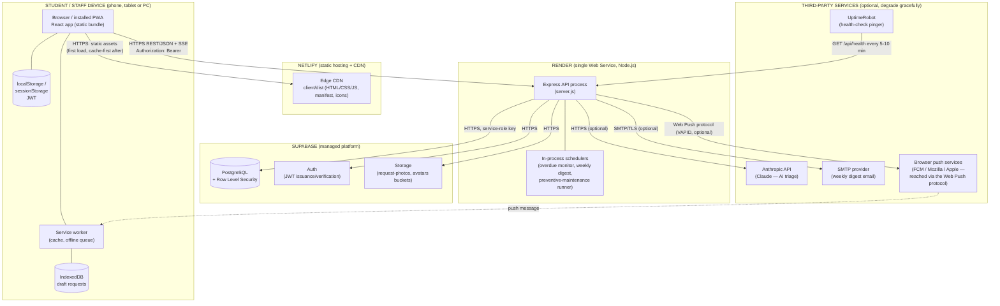

# Physical Architecture

Companion to [ARCHITECTURE.md](ARCHITECTURE.md) and
[LOGICAL_ARCHITECTURE.md](LOGICAL_ARCHITECTURE.md). This document is the
**deployment view** (UML deployment diagram in spirit): the real nodes the
system runs on, what executes where, and how they talk to each other over
the network. Where the logical architecture asks "how is the software
layered?", this document asks "which machine is actually running that
layer, and what happens if it goes away?".

---

## 1. Deployment diagram

---

## 2. Nodes and what runs on each

| Node | What runs there | Technology | Notes |
|---|---|---|---|
| **Student/staff device** | The React app itself (downloaded once, then mostly served from cache), the service worker, an offline draft queue, the session token | Chrome/Safari/Firefox, any phone/tablet/PC | Not a server the project operates — literally whichever device a student owns. This is why the whole client tier had to be built to tolerate a slow or absent connection (see §8 of ARCHITECTURE.md). |
| **Netlify** | Static hosting for the built client (`client/dist`) behind a CDN | Netlify's edge network | Stateless. A deploy is just new static files; there is no server-side process here at all, so it cannot itself crash or need restarting. `client/public/_redirects` makes deep links resolve to `index.html` (a single-page app). |
| **Render (Web Service)** | The one Express process for the whole API, plus the background job timers running **inside that same process** (`setInterval`, not a separate worker) | Node.js 22, Express 5 | A single node — see §3 for what that implies. Free tier sleeps after ~15 minutes idle, which is why UptimeRobot pings it. |
| **Supabase** | Managed PostgreSQL, Auth (issues/verifies the JWTs used everywhere else), Storage (photo buckets) | Supabase platform (itself running on AWS infrastructure, abstracted away from this project) | The project's only stateful, durable node. Everything else can be redeployed from scratch without data loss; this is the one thing that is backed up. |
| **Anthropic API** (optional) | AI category/priority suggestions | `@anthropic-ai/sdk` over HTTPS | Absence is handled: the keyword-rules engine answers instead (§7.6 of TECHNICAL_DOCUMENTATION.md). |
| **SMTP provider** (optional) | Delivers the weekly summary email | `nodemailer` over SMTP/TLS | Absence is handled: the digest job is skipped, "Email me the summary" returns a clear `503`. |
| **Browser push services** (optional) | The last hop of a Web Push notification, run by each browser vendor (not by this project) | Web Push protocol (VAPID) | Absence (no VAPID keys) is handled: subscribing returns `503`, nothing else affected. |
| **UptimeRobot** | External health-check pinger | HTTP GET | Not part of the application; a free third-party monitor pointed at `/api/health` purely to keep Render's free tier warm. |

---

## 3. What "one node" implies

Render runs **exactly one instance** of the API process. That single-node
choice is deliberate for this project's scale, but it has consequences that
are worth stating plainly rather than discovering by surprise:

- **In-memory state lives and dies with that one process.** The live-update
  hub (Server-Sent Events connections, `events.service.js`), the profile
  cache, the AI/comments/feedback rate limiters, and the scheduled jobs
  themselves all keep their state in ordinary JavaScript variables in that
  one process. This is safe and simple *because* there is only one process —
  two instances behind a load balancer would each keep their own separate
  copy of "who's connected" and "who's rate-limited", which breaks both.
- **Background jobs cannot double-run.** Because the overdue monitor, the
  weekly digest and the preventive-maintenance runner are `setInterval`
  timers inside the single API process, there is exactly one of each ever
  running — no distributed-lock or "which instance owns this job" problem
  to solve, which a multi-node deployment would introduce.
- **A restart drops live connections and in-flight timers**, not data. Every
  durable fact (requests, status history, subscriptions, schedules,
  feedback) lives in Supabase, not in the API process — a redeploy or crash
  loses nobody's data, only the currently-open SSE streams (which
  reconnect automatically, see `hooks/useLive.jsx`) and resets the
  in-memory rate limiters and caches to empty.
- **Scaling to more than one node is future work**, not a currently-built
  feature, and is flagged as such in ARCHITECTURE.md §13 ("known
  limitations") and §14 ("future work") — it would need the in-memory pieces
  above moved to a shared store (e.g. Redis), which is exactly the kind of
  change this document exists to make an informed decision about, without
  having to change anything in [LOGICAL_ARCHITECTURE.md](LOGICAL_ARCHITECTURE.md).

---

## 4. Network and protocols

| Link | Protocol | Auth | Notes |
|---|---|---|---|
| Device → Netlify | HTTPS | none (public static files) | First load fetches `index.html` + hashed JS/CSS bundles; the service worker then serves hashed assets from its own cache on every later visit, bypassing the network entirely |
| Device → Render API | HTTPS, REST/JSON | `Authorization: Bearer <JWT>` on every protected route | Includes one long-lived `GET /api/events` connection per open tab (Server-Sent Events) for live updates |
| Render API → Supabase | HTTPS | Service-role key (server-side secret, never sent to the device) | The **only** place this key is used — see the logical-architecture rule that only `repositories/*.js` may hold it |
| Render API → Anthropic / SMTP / Web Push | HTTPS / SMTP+TLS / Web Push (VAPID) | Per-provider API key or certificate, all optional | Each is a genuinely separate outbound call the API makes on the business logic layer's behalf (`push.service`, `digest.service`, `triage.service`) — none of them are reachable from, or aware of, the device directly |

**HTTPS everywhere** is provided by the hosts themselves (Netlify and
Render both terminate TLS automatically) rather than configured by this
project's own code — one less thing to get wrong, and consistent with
CLAUDE.md's non-functional requirement that the transport be encrypted
end to end.

---

## 5. Deployment order and environment configuration

Matches [TECHNICAL_DOCUMENTATION.md §14](TECHNICAL_DOCUMENTATION.md#14-deployment)
exactly; restated here as *which node* each step configures:

1. **Supabase** — run all SQL migrations (`server/sql/001`…`016`); this node
   must exist and be schema-complete before the API node can do anything useful.
2. **Render** — deploy the API with `SUPABASE_URL` / `SUPABASE_SERVICE_ROLE_KEY`
   (required) and the optional variables for whichever third-party nodes are
   in use (VAPID keys, SMTP credentials, `ANTHROPIC_API_KEY`). Note its public URL.
3. **Netlify** — deploy the client with `VITE_API_BASE_URL` pointing at the
   Render URL from step 2. This is baked into the static bundle **at build
   time**, which is why changing it requires a rebuild, not just a config edit.
4. **UptimeRobot** (optional but recommended on the free tier) — point it at
   `https://<render-service>/api/health` so the Render node is rarely asleep
   when a real user arrives.

Each node redeploys independently: a client-only change only touches
Netlify; a server-only change only touches Render; a schema change requires
a manual step in Supabase's SQL editor (deliberately manual — an automatic
migration runner was judged more risk than benefit at this project's scale).

---

## 6. Physical failure modes

Stated here because a deployment view is the natural place to ask "what
breaks first, and what still works?":

| If this node is unavailable | User-visible effect | What still works |
|---|---|---|
| Netlify / CDN | The app cannot be freshly loaded | Anyone with the app already cached/installed can keep using it against the API directly |
| Render API | No requests, dashboards or notifications can be created, read or sent | The already-loaded app shell renders from cache (offline shell); a student can still draft a request offline, queued for when the API returns |
| Supabase | The API returns errors on every data operation | The client's stale-while-revalidate cache still shows the last-seen data for already-visited pages; nothing new can be read or written |
| Anthropic / SMTP / Web Push | AI suggestions / weekly email / push notifications silently stop | Every core flow (report, assign, resolve) is completely unaffected — this is exactly why these three are optional configuration, not hard dependencies (§7.6, §11 of TECHNICAL_DOCUMENTATION.md) |
