# System Sequence Diagrams

Elaboration Iteration 1 deliverable (UP), companion to
[USE_CASES.md](USE_CASES.md). A **system sequence diagram (SSD)** treats the
whole application as a single black box (`:System`) and shows only the
messages that cross the actor/system boundary — no internal layers, no
services, no database. That internal detail belongs to the *design*
sequence diagram in [LOGICAL_ARCHITECTURE.md §4](LOGICAL_ARCHITECTURE.md#4-sequence-across-the-layers--one-concrete-example),
which deliberately shows the opposite: nothing *but* the internal layers,
for one of the use cases below (UC-16), so the two documents are direct
counterparts of each other at two different zoom levels.

One SSD per primary use case from [USE_CASES.md §3](USE_CASES.md#3-primary-use-cases--fully-dressed-12-of-40-30) —
the same 12, in the same order.

---

### UC-2 — Log in

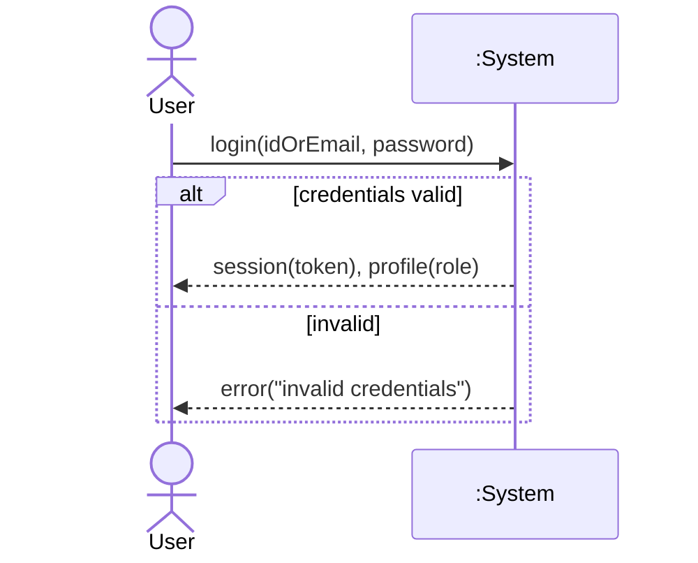

### UC-3 — Submit a maintenance request

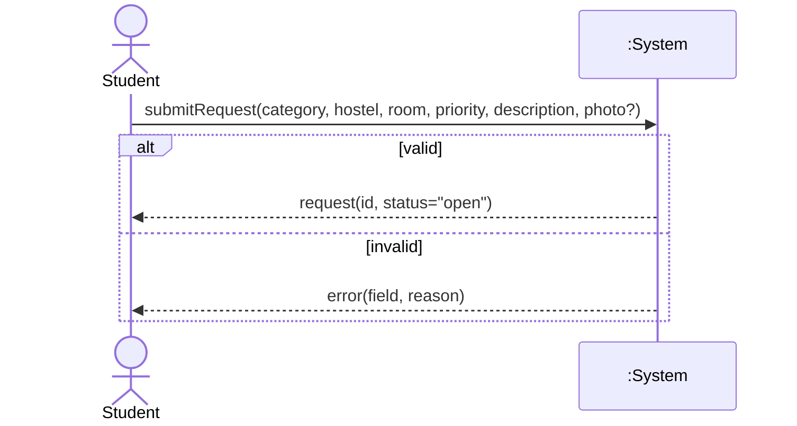

### UC-9 — Get a triage suggestion

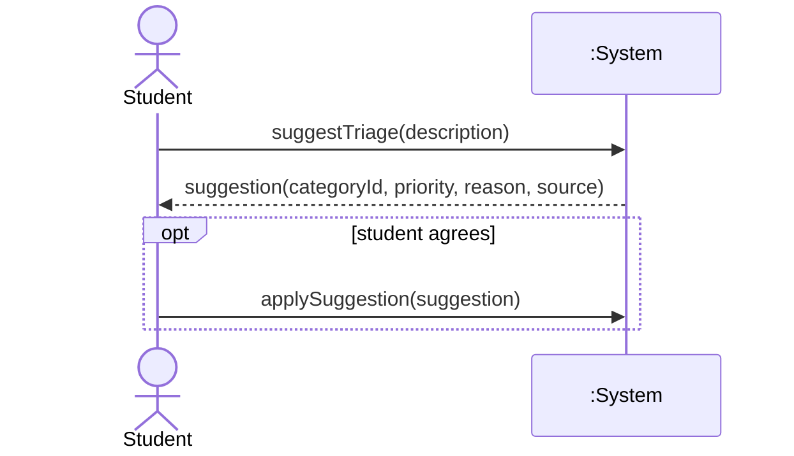

### UC-6 — Back an existing report ("Me too")

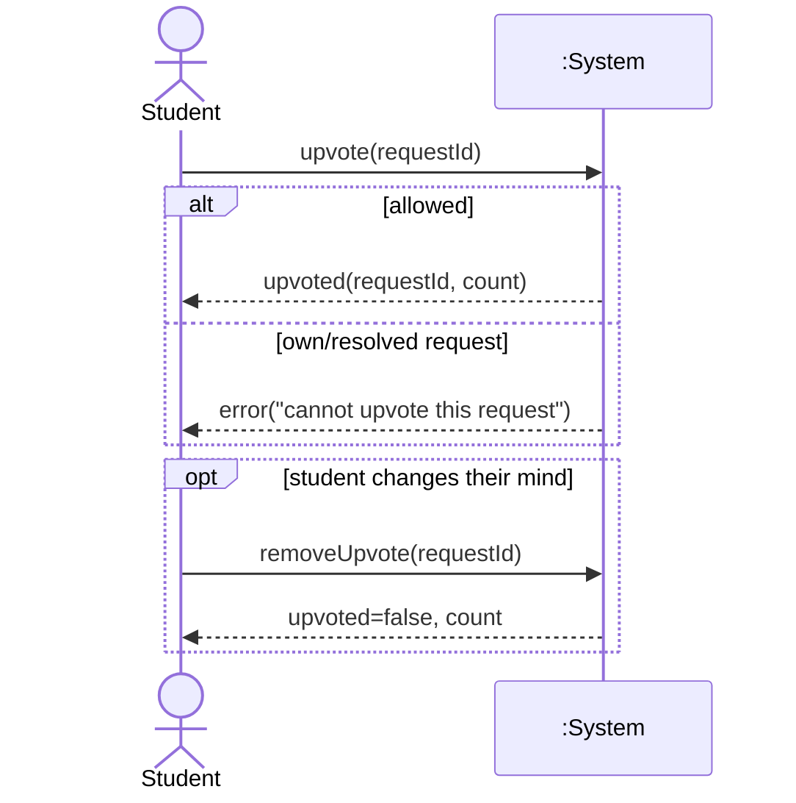

### UC-16 — Update the status of an assigned request

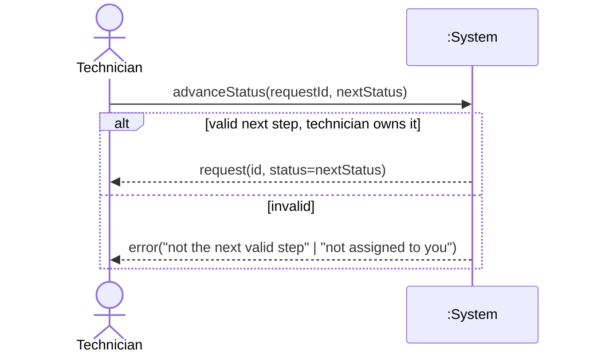

### UC-17 — Attach proof of finished work

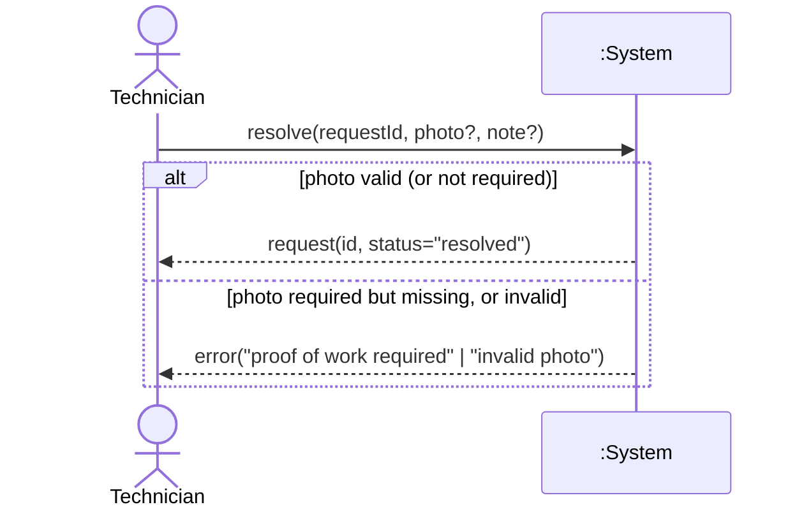

### UC-23 — Assign a technician to a request

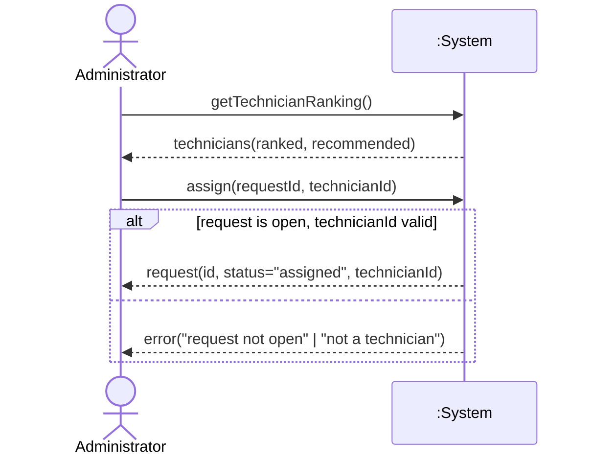

### UC-10 — Draft a request offline

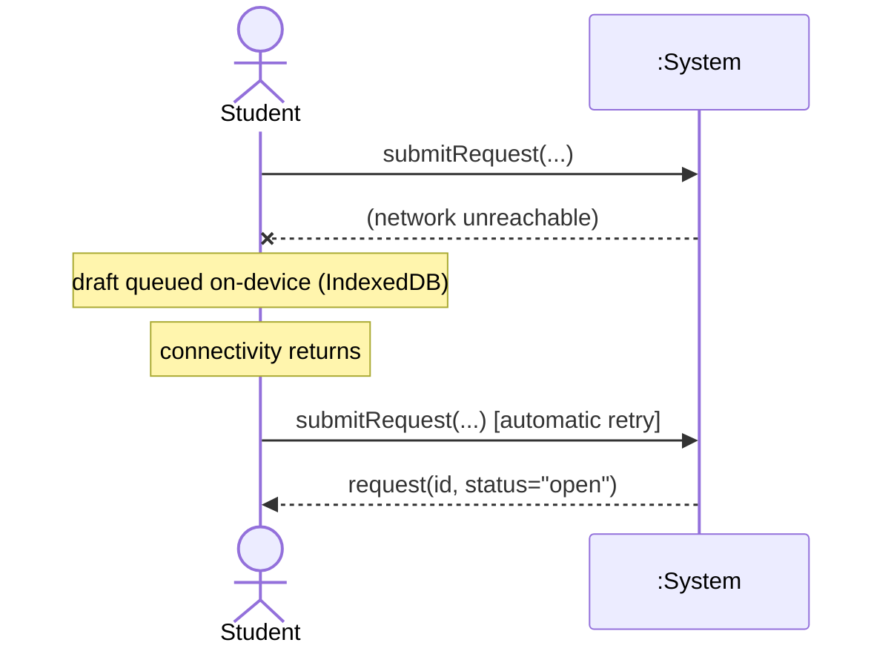

### UC-31 — View recurring-issue detection

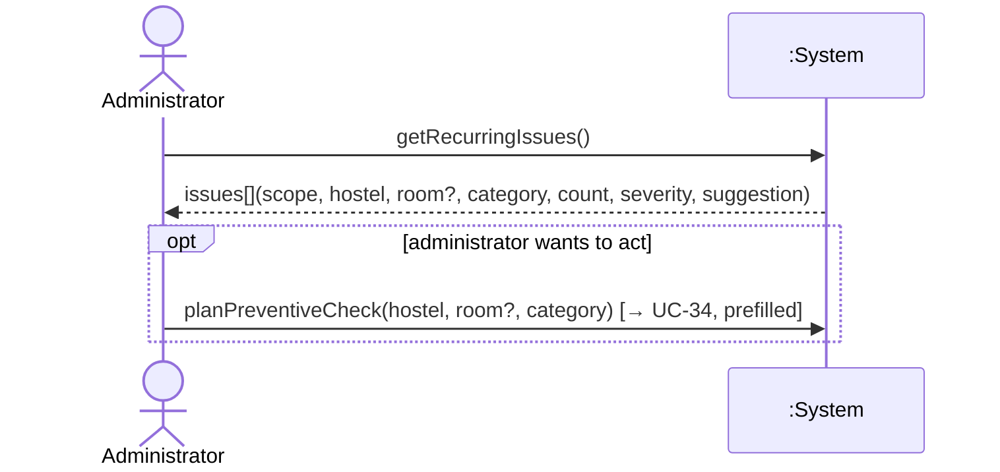

### UC-38 — Generate a request when a schedule falls due

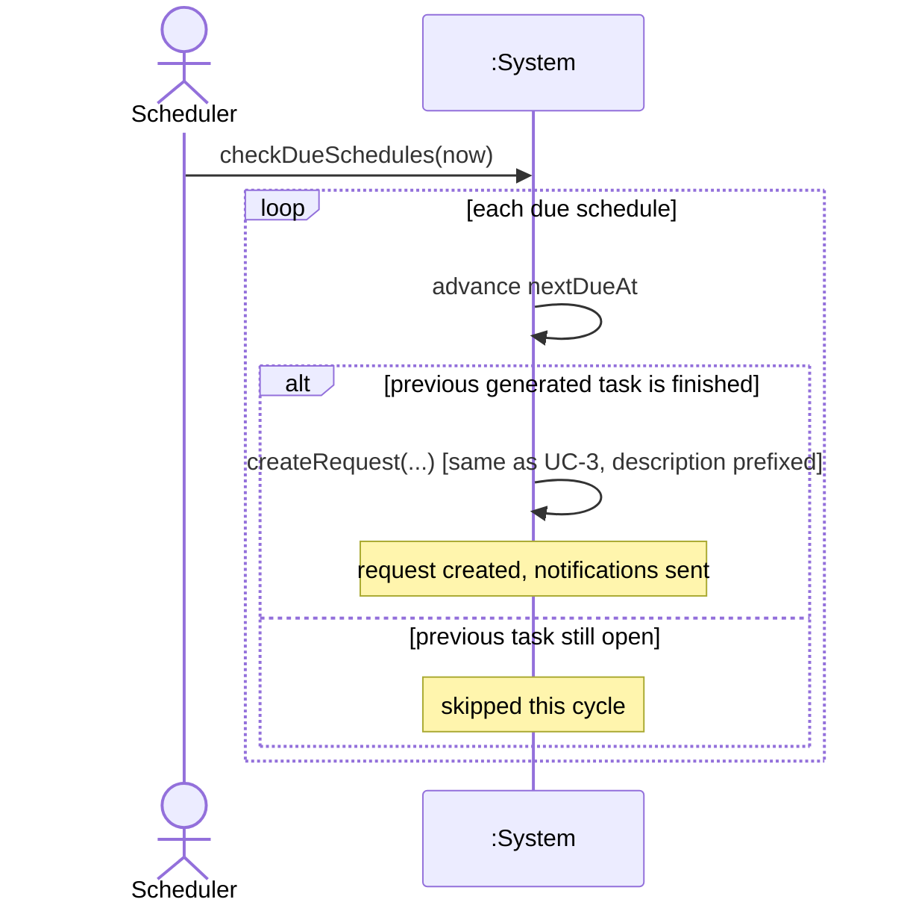

### UC-39 — Detect and alert on an overdue request

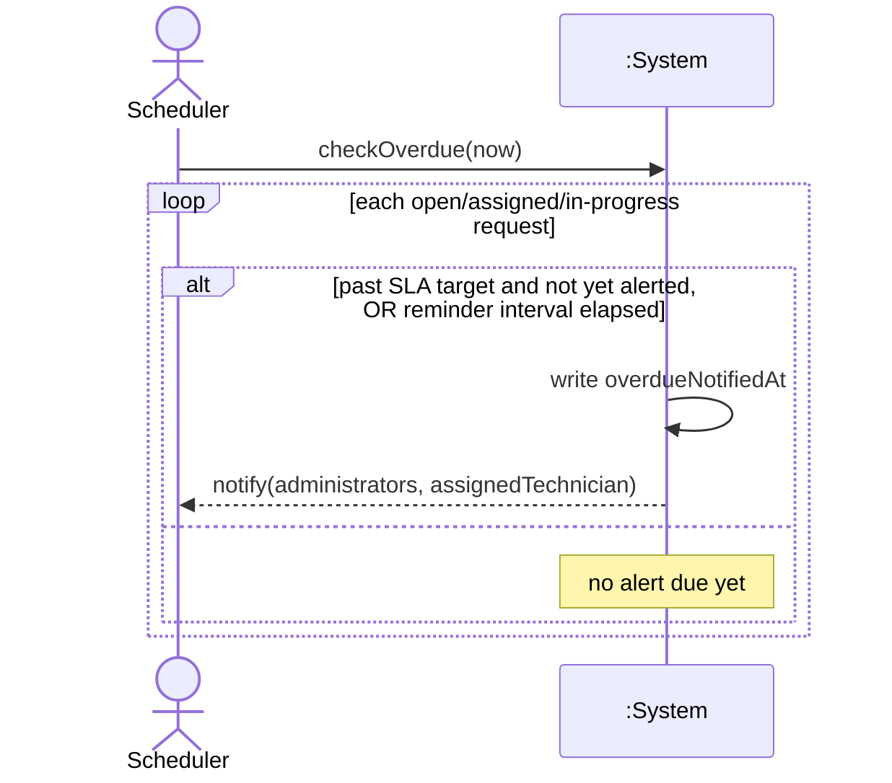

### UC-13 — Submit app feedback

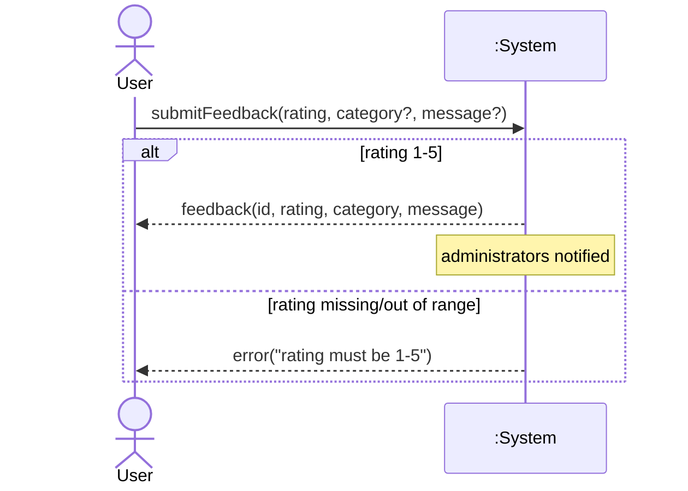
