# User Manual

**UNZA Hostel Maintenance** — report, track and resolve hostel maintenance issues.

This manual explains how to use the system, step by step, for each kind of user.
Jump to your section:

- [1. Getting started (everyone)](#1-getting-started-everyone)
- [2. Students](#2-students)
- [3. Technicians](#3-technicians)
- [4. Administrators](#4-administrators)
- [5. Settings, notifications and dark mode](#5-settings-notifications-and-dark-mode)
- [6. Working offline](#6-working-offline)
- [7. Meanings of statuses, priorities and badges](#7-meanings-of-statuses-priorities-and-badges)
- [8. Frequently asked questions](#8-frequently-asked-questions)

> The screenshots use sample data.

---

## 1. Getting started (everyone)

### What you need
A phone, tablet or computer with a web browser and an internet connection. No
download from an app store is required.

### Roles
| Role | What you can do |
|---|---|
| **Student** | Report faults, back faults others have reported, track your own requests, rate repairs |
| **Technician** | See the jobs assigned to you, update their progress, add proof of the finished work |
| **Administrator** | See every request, assign technicians, manage staff accounts, view reports |

### Creating an account (students only)
Students register themselves; technician and administrator accounts are created
for you by an administrator.

1. Open the website and choose **Sign up as Student** under the sign-in form.
2. Enter your **full name**, **student ID**, **email address** and a **password** (at least 8 characters).
3. Submit. You can now sign in.

### Signing in
1. Enter your **Student or Staff ID** and your password, then press **Sign In**.
2. Prefer email? Choose **Log in with email instead**.
3. Tick **Remember this device** on your own phone or laptop so you stay signed in. Leave it unticked on a shared computer.

| Computer | Phone |
|---|---|
|  |  |

### Installing the app on your phone (recommended)
The site is a *Progressive Web App*: you can add it to your Home Screen so it opens
like a normal app, loads faster and can send you notifications.

- **Android (Chrome):** open the site → menu (⋮) → **Install app** / **Add to Home screen**.
- **iPhone (Safari):** open the site → **Share** button → **Add to Home Screen**.
  (On iPhone, notifications only work after you do this.)

### Finding your way around
- **Computer:** the menu is on the left; the top bar has search, dark-mode toggle, notifications, help and your profile.
- **Phone:** tap the **☰** button (top left) to open the menu.

### The top bar
| Icon | What it does |
|---|---|
| 🌙 / ☀️ | Switch between dark and light mode |
| 🔔 | Recent activity (a red dot means there is something new) |
| ⓘ | Help — a short guide to what each status means |
| Your name | Profile and sign out |

---

## 2. Students

### 2.1 Your dashboard
After signing in you see:

- **Announcements** — notices from administrators for your hostel, or for everyone (see 2.1a).
- **Active Requests** and **Completed** — how many of your requests are still being worked on or finished.
- **Report New Issue** — the big green button.
- **Already reported in your hostel** — issues other students have already reported (see 2.3).
- **Recent Requests** — your latest requests with their status.

| Phone | Computer |
|---|---|
|  |  |

### 2.1a Announcements
Notices from administrators appear at the top of your dashboard — either for **your hostel** only, or for **all hostels**. Each one shows who posted it and when.

- Tap **✕** to dismiss a notice you have read. It will not show again on this device.
- You also get a **push notification** for a new announcement, if you turned notifications on (see [section 5](#5-settings-notifications-and-dark-mode)).
- Which notices you see depends on your **hostel** — set it once in Settings (see 5) so you get the right ones.

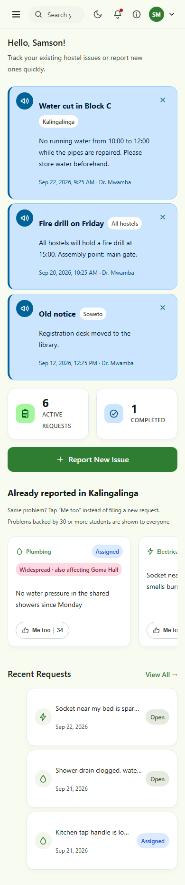

### 2.2 Report a new issue
1. Press **Report New Issue**.
2. **Choose a category** (Plumbing, Electrical, Furniture …).
3. **Select your hostel** and, if you like, type your **room**.
4. **Say how urgent it is** — Low, Medium, High or Critical (see [section 7](#7-meanings-of-statuses-priorities-and-badges)).
5. **Describe the problem.** Be specific: *"The tap in the bathroom leaks even when tightly closed."*
6. *(Optional)* **Attach a photo** — press **Take photo** to use your camera (on a computer, a live preview opens so you can capture one), or **Choose from files** to pick an existing picture (JPG, PNG or WebP, up to 5 MB). Large photos are shrunk automatically so they upload quickly.
7. Press **Submit Request**.

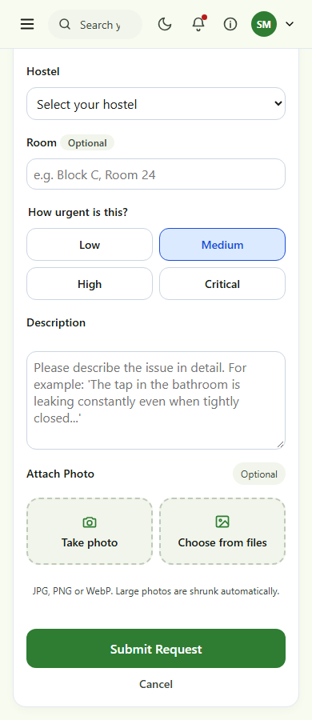

**Two helpers appear while you fill the form:**

- **"Already reported in your hostel"** — after you pick a category and hostel, if someone has already reported the same kind of problem you will see it here. If it is *your* problem too, tap **Me too** instead of filing a new request. You help the maintenance team see how many people are affected.
- **A suggestion** — as you describe the problem, the system may suggest a category and urgency ("Looks like Electrical, Critical priority"). Tap **Apply** to accept it or **Dismiss** to ignore it. **You are always in control** — nothing changes unless you tap Apply. Dangerous problems (fire, sparking wires, flooding, burst pipes) are always suggested as *Critical*.

> **No internet?** You can still write the request. It is saved on your device and sent automatically when you are back online (see [section 6](#6-working-offline)).

### 2.3 Back a problem someone else already reported ("Me too")
On your dashboard, swipe through **Already reported in &lt;your hostel&gt;**. Each card
shows the category, a short description and its status.

- Tap **Me too** if you have the same problem. The button turns green and shows **Upvoted**.
- Tap it again to take your vote back.
- You cannot vote on your own requests, or on ones that are already resolved.
- Other students' names are never shown.
- **Widespread problems (30 or more "Me too" votes)** are shown to students in **every** hostel, not just where it was reported — labelled **"Widespread · also affecting &lt;hostel&gt;"**. A fault that big is probably a campus-wide issue (e.g. water pressure), so everyone affected can back it.

### 2.4 Track your requests
Open **My Requests** in the menu. Use the tabs to switch between active and finished requests, or the search box in the top bar to find one.

| Computer | Phone |
|---|---|
|  |  |

Tap any request to see its full page:

- the **status** and **priority**,
- who is **assigned** to fix it,
- a **Comments** box to talk with the technician and administrators about your request (e.g. "Which tap is it?"),
- a **timeline** showing every step with dates,
- for finished jobs, a **Work Completed** section with the technician's photo and note.

**Comments** — type your message and press **Send** (or Ctrl+Enter). Only you, the technician assigned to your request, and administrators can see or post comments on it — nobody else. Everyone involved gets a notification when someone new comments. Comments are turned off once a request is Closed.

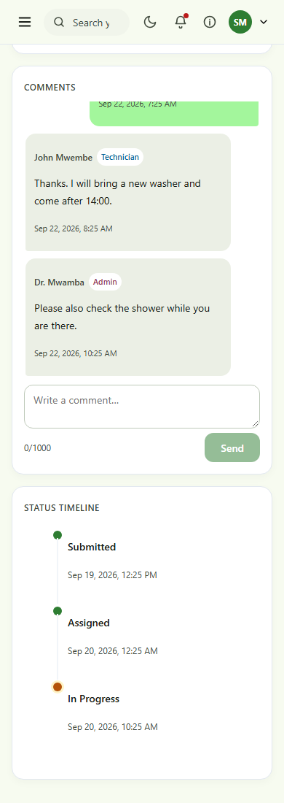

The page updates by itself when something changes — you do not need to refresh. You
can also press **Refresh Status**.

### 2.5 Rate a finished repair
When a request is **Resolved** or **Closed**, the request page shows **Rate this
repair**. Tap 1–5 stars (5 is best) and, if you wish, add a comment. You can rate each request once.

### 2.6 Give feedback about the app
Rating a repair (2.5) is about one technician's work on one request. If instead you
want to say something about the **app itself** — a bug, a suggestion, or just how
it's working for you overall — open **Feedback** in the menu. This is different
from anything else in the system: it is the one channel that goes straight to the
people building the app, for a student who does not otherwise have a direct line
to them the way an administrator does.

1. Tap a **star rating** (1–5) for the app overall.
2. Choose what it's about — **General feedback**, **A suggestion**, or **Something is broken**.
3. *(Optional)* Add details.
4. Press **Send Feedback**.

Your past feedback is listed below the form so you can see what you've already sent.

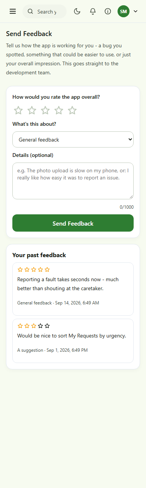

---

## 3. Technicians

### 3.1 Your dashboard
- **Announcements** from administrators appear at the top, the same as on a student's dashboard (2.1a) — you see every active notice, whatever hostel it targets, since your next job could be anywhere.
- Choose your **status** at the top — **Available**, **On Job** or **Off Duty**. Administrators use this when deciding who to assign, so keep it accurate.
- See how many jobs are **Assigned** to you and how many you have **Completed**.
- **My Performance** — your scorecard for the last 30 days: jobs resolved, average time, your on-time rate, and your rating from students. It also shows your rank among your colleagues, and warns you if any of your jobs are overdue.
- **My Active Tasks** lists faults students have reported to you, with their priority and a deadline badge.
- **My Maintenance Jobs** lists your scheduled preventive-maintenance checks separately (see 4.7) — kept apart from student-reported faults so you can tell at a glance which is which.

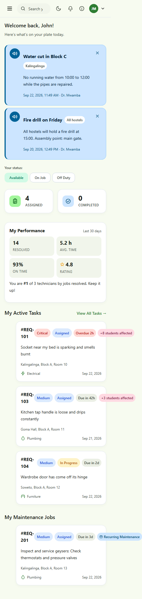

### 3.2 See your tasks
Open **My Tasks**. Each card shows the request number, priority, status, a
deadline badge (for example *Due in 42h* or *Overdue 3h*), a **"+N students affected"** badge when several students backed the same issue with "Me too" (see 2.3) — tackle those first — the description and the location. A task that came from a preventive-maintenance schedule rather than a student report carries a **"Recurring Maintenance"** badge, on this list, the dashboard and the task's own page — opening it shows "Maintenance Schedule" instead of a reporting student, since nobody personally filed it.

### 3.3 Work on a task
Tap a task to open it. You will see who reported it, the description, the student's
photo (if any), and the timeline.

1. When you begin, press **Start Task**. The status changes to *In Progress* and the student is notified.
2. When the repair is done, complete the **Action Panel** (below) and press **Mark as Resolved**.

### 3.4 Add proof of the finished work (optional)
When you resolve a task you can:

- **Add a photo** of the finished repair — press **Take photo** (your camera opens on a phone; a live preview opens on a computer) or **Choose from files**. Use **Retake photo** if needed.
- **Add a note** (up to 500 characters), e.g. *"Replaced the washer and tested for leaks."*
- You can also **Comment** on the task to ask the student or administrators a question (see 2.4).

The student and the administrators will see this under **Work Completed**. Photos are
automatically reduced in size so they upload quickly on mobile data.

> You can only update tasks that are **assigned to you**.

### 3.5 Give feedback about the app
Same as for students (2.6): open **Feedback** in the menu to send a star rating,
a category (general / suggestion / bug) and an optional comment about the app
itself — not about one job. It's the way to reach the development team directly.

---

## 4. Administrators

### 4.1 Dashboard
A quick health check of maintenance operations:

- **Avg. Resolution Time**, **Requests This Month**, **Resolved This Month**.
- **Overdue Requests** — turns red when any request has passed its target time. Tap it to go to the list.
- **Issue Categories** ring and **Resolution Trend** chart.
- **Needs Attention** — open requests not yet assigned, most urgent first.

### 4.2 Manage requests and assign a technician
Open **Manage Requests**. Use the **Overdue** tab to see, at a glance, every request that has passed its target time — regardless of its status — with a count badge. The dashboard's **Overdue Requests** tile (4.1) opens straight into this tab.

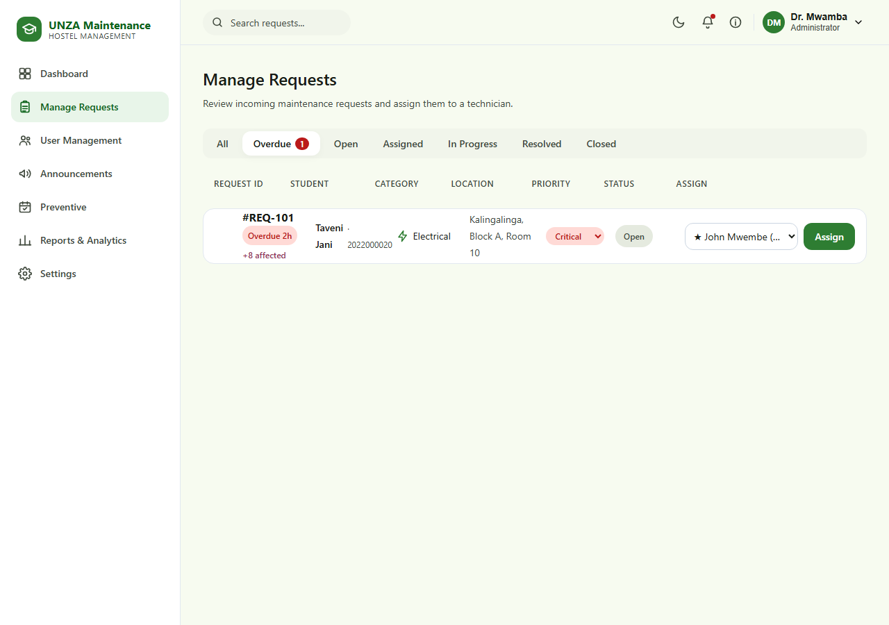

Every request appears with:

| What you see | Meaning |
|---|---|
| **Overdue 2h / Due soon · 4h / Due in 2d** | The resolution deadline (see [section 7](#7-meanings-of-statuses-priorities-and-badges)) |
| **+8 affected** | How many other students used **Me too** on this issue |
| **Priority** dropdown | Change urgency at any time |
| **Assign** column | Choose a technician and press **Assign** |

**To assign:** open the technician dropdown, choose someone and press **Assign**. The
system marks a **★ recommended** technician — the one who is available and has the
fewest active jobs — and pre-selects them, so assigning is usually one tap.
Each entry shows workload, e.g. *★ John Mwembe (1 active)*. People who are *Off Duty* are never recommended.

Use the tabs (All, Open, Assigned, In Progress, Resolved, Closed) to filter, or the top search box (by number, description, category, student name or ID).

### 4.3 A single request
Click a request number to open its page: the reporter, the full description, the photo, a **Comments** box (you, the student and the assigned technician can talk there — see 2.4), the timeline, the technician's **Work Completed** proof and the student's rating. From here you can also:

- change **priority**,
- **assign** a technician (open requests),
- **advance the status** (Mark In Progress, Mark as Resolved, Close Ticket).

### 4.4 Manage staff accounts
Open **User Management** to see every account and filter by role.

To create a technician or administrator: press **Add Staff Account**, fill in the
full name, staff ID, email, a temporary password (at least 8 characters) and the role,
then **Create Account**. Give the person their staff ID and temporary password.
Students cannot be created here — they register themselves.

### 4.5 Reports and analytics
Open **Reports & Analytics**:

- Summary numbers including **Average Rating**.
- **Resolution Trend** for the last 7 days.
- **Hostel Hotspots** — a grid of hostels × categories; **darker = more requests**. The sentence above it names the busiest hostel. Use **All time / Still open** to switch between history and what needs doing now.
- **Requests by Category**, **Requests by Hostel** and **Technician Workload**.
- **Technician Performance** — a table ranking every technician by jobs resolved, average time, on-time rate, jobs on hand, overdue count and student rating, over a window you choose (7/30/90 days or all time).
- **Needs a Permanent Fix** — faults that keep coming back to the **same room** (3 or more times in 60 days) or across a **whole hostel** (6 or more times in 30 days), with a suggestion and a **"Plan a preventive check"** link (see 4.7).

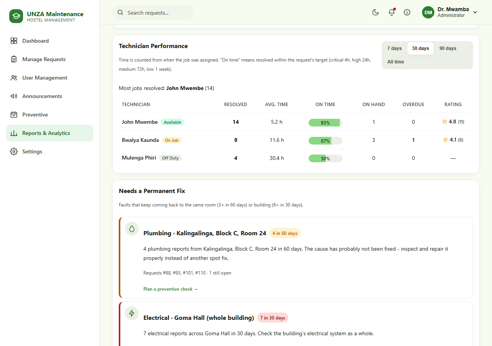

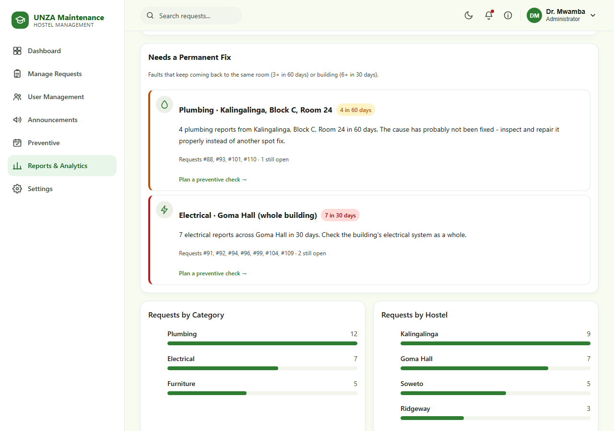

**Export and share**
- **Export CSV** — downloads every request as a spreadsheet.
- **Print / Save as PDF** — produces a clean printable report.
- **Email me the summary** — sends the weekly summary to your own email address straight away.

### 4.6 Send an announcement
Open **Announcements** to notify students. This is for hostel-wide notices — a water cut, a fire drill, anything everyone in a building (or everyone, full stop) needs to know.

1. Write a **Title** and a **Message**.
2. Choose **Send to** — one hostel, or **All hostels**.
3. Choose when it **Expires** (or leave it to never expire).
4. Press **Post announcement**.

Students in the audience see it as a banner on their dashboard (2.1a) and get a push notification. The list below the form shows every announcement you have posted, whether it is still **Active** or has **Expired**, and lets you **Delete** one early.

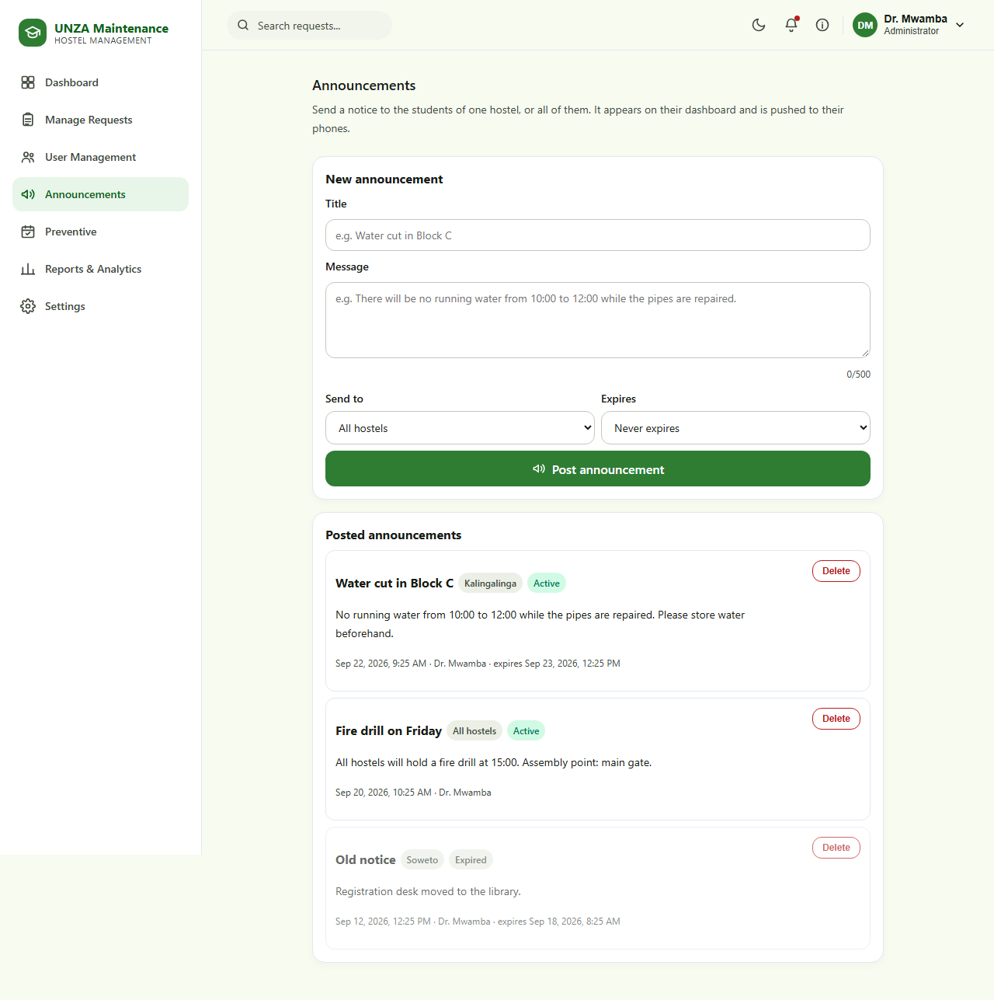

### 4.7 Preventive maintenance
Open **Preventive** to schedule recurring checks — inspecting the geysers every month, testing fire extinguishers every quarter — so problems are caught before a student has to report them.

1. Press **+ New schedule**.
2. Fill in **what needs doing**, the **category**, **hostel** (and, optionally, a specific room/area), **how often**, the **priority** of the task it creates, and when the **first task is due**.
3. Press **Create schedule**.

When a schedule falls due, the system creates a normal maintenance request for it automatically — it goes through assignment, technician work and proof of work exactly like a student-reported request, just labelled *"Preventive maintenance: ..."*. A new task is **not** created while the previous one for that schedule is still open, so tasks never pile up.

For each schedule you can:
- **Run now** — create its task immediately, without waiting for it to fall due.
- **Pause** / **Resume** — Resuming moves the next due date into the future, so it does not fire instantly for an old date.
- **Delete** — removes the schedule; tasks it already created are kept.

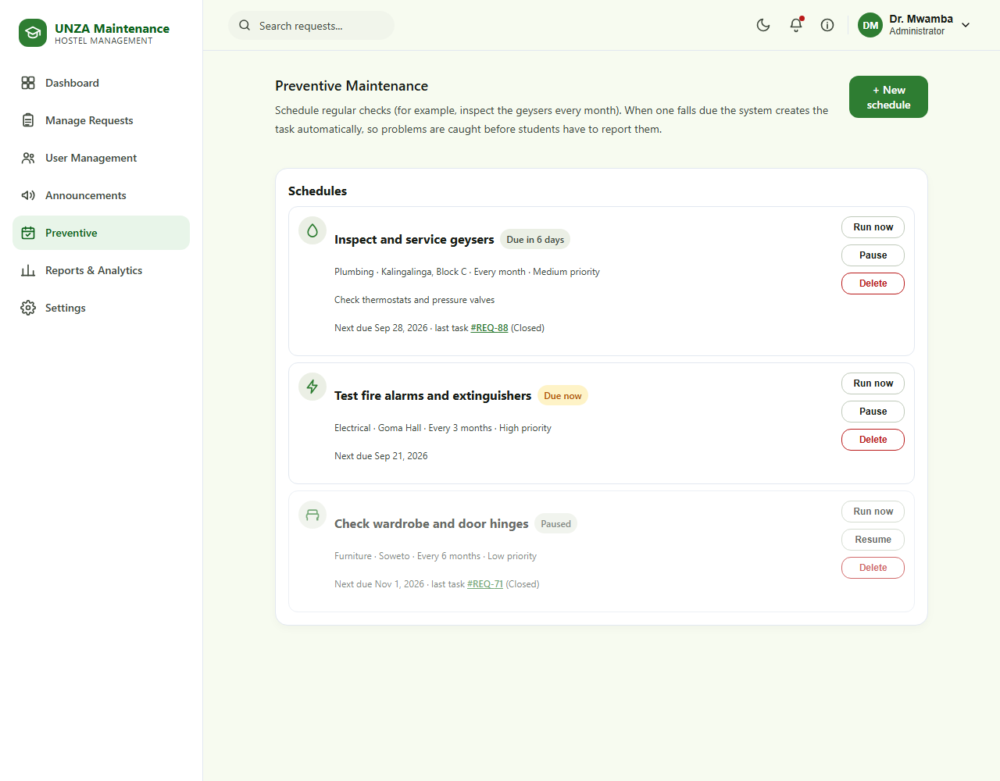

> **Tip:** on the **Needs a Permanent Fix** card (4.5), press **Plan a preventive check** to jump here with the hostel, room and category already filled in.

### 4.8 Automatic alerts and emails
You do not need to do anything for these:
- **Overdue alerts** — the system checks every hour for requests that have passed their deadline and notifies all administrators and the assigned technician. If a request stays overdue you get a **reminder**: every **4 hours** for Critical and High requests, and **once a day** for Medium and Low. Reminders stop as soon as the request is Resolved.
- **New request and status alerts** — push notifications (if you turned them on).
- **Weekly summary email** — every Monday at 08:00 (Lusaka time) to all administrators.
- **Preventive maintenance tasks** — created automatically when a schedule (4.7) falls due.

### 4.9 App Feedback
Students and technicians can send a star rating and a comment about the app
itself at any time (see 2.6 / 3.5) — not tied to any particular request. Open
**App Feedback** to read what has come in: the **average rating** and **total
reviews** at the top, then every submission with who sent it, filterable by
category (**Bug**, **Suggestion**, **General**). You also get a push
notification the moment a new one arrives. This is the channel for feedback
from people who don't otherwise have a direct line to the development team.

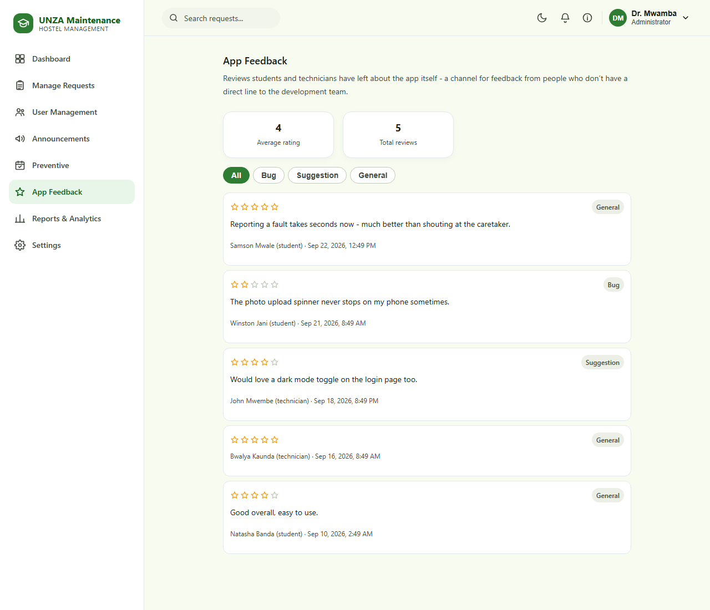

---

## 5. Settings, notifications and dark mode

Open **Settings** in the menu.

- **Profile** — change your **name** or **photo** (**Edit Profile**, or tap the camera on your picture). Your ID, email and role cannot be changed here.
- **My hostel** *(students only)* — choose where you live so you receive announcements for your hostel (4.6) and your "Already reported" feed defaults to the right place.
- **Appearance** — choose **System** (follows your device), **Light** or **Dark**. The 🌙 button in the top bar switches quickly.
- **Push Notifications** — turn on alerts on *this device*, even when the app is closed. You are asked for permission once. If you previously pressed "Block", allow notifications for the site in your browser settings first.
- **Sign Out** — sign out safely. This also stops notifications on that device, so nobody else using the phone receives yours.

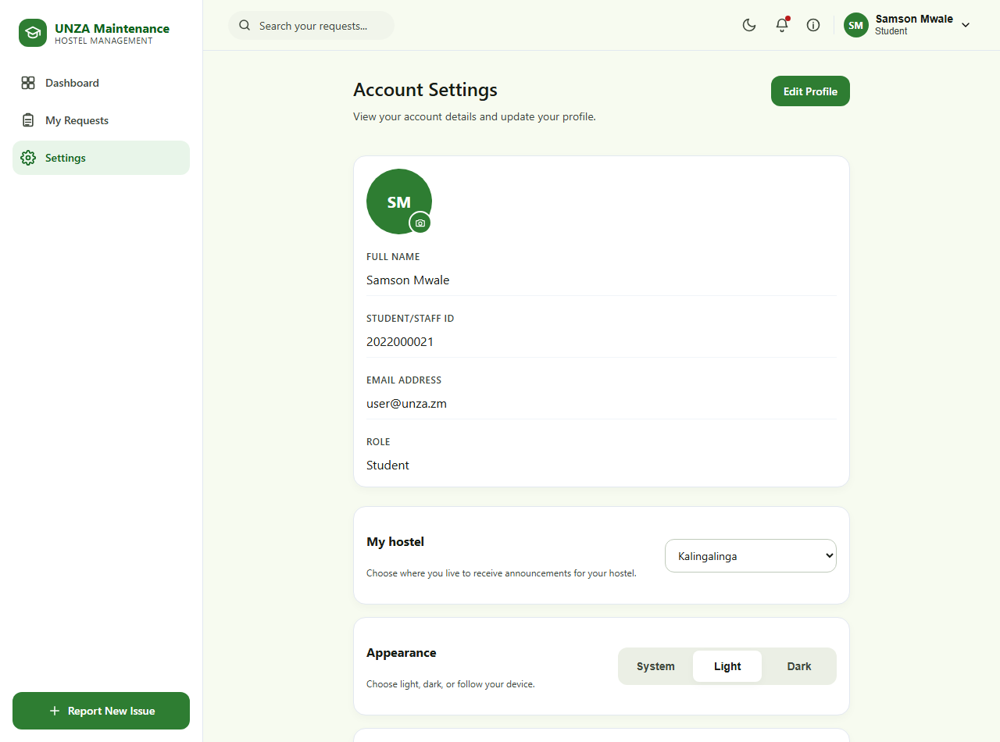

**Dark mode**

| Admin (computer) | Student (phone) |
|---|---|
|  |  |

**Who gets which notifications**

| You are | You are notified when |
|---|---|
| Student | your request is assigned, or its status changes |
| Technician | a task is assigned to you, or one of yours becomes overdue |
| Administrator | a new request is submitted, or a request becomes overdue |

---

## 6. Working offline

Hostel Wi-Fi is not always reliable, so the app is built to cope:

- **Pages you have visited** still open quickly, even on a poor connection.
- **Students can write a new request with no connection.** It appears in **My Requests** under *drafts* and is sent automatically when you are back online. You do not need to do anything.
- Other actions (assigning, changing status, rating) need a connection; you will see a message telling you to check your connection if the app can't reach the server — being connected to Wi-Fi does not always mean you have real internet access, so this is worth checking first before assuming something is broken.
- **A brief drop in connection will not sign you out.** If the app can't confirm your session because you're offline for a moment, it keeps you signed in and quietly checks again once your connection returns, instead of sending you back to the login screen.

---

## 7. Meanings of statuses, priorities and badges

### Status (the life of a request)
`Open → Assigned → In Progress → Resolved → Closed`

| Status | Meaning |
|---|---|
| **Open** | Submitted, waiting for an administrator to assign a technician |
| **Assigned** | A technician has been chosen |
| **In Progress** | The technician has started work |
| **Resolved** | The repair is finished (you can rate it) |
| **Closed** | Fully completed and filed |

A request always moves forward one step at a time; it cannot skip or go backwards.

### Priority and target time
The clock starts when the request is reported and stops when it is Resolved.

| Priority | Use it for | Target |
|---|---|---|
| **Critical** | Danger or serious damage: sparking wires, flooding, burst pipe, gas smell | 4 hours |
| **High** | Loss of an essential service: no water, no power, door or window that won't lock | 24 hours |
| **Medium** | A real fault, but not urgent: dripping tap, dead socket | 72 hours |
| **Low** | Cosmetic or minor: squeaky hinge, scuffed paint | 1 week |

### Deadline badges (staff)
| Badge | Meaning |
|---|---|
| **Due in 2d** (grey) | Plenty of time left |
| **Due soon · 4h** (amber) | Less than a quarter of the time remains |
| **Overdue 2h** (red) | The target has passed — needs attention now |
| *(no badge)* | Already resolved or closed |

---

## 8. Frequently asked questions

**I forgot which ID to use.**
Students use their **student ID**; staff use their **staff ID** (for example `STF-1001`). You can also choose *Log in with email instead*.

**Can I edit or cancel a request after submitting it?**
Not yet. If something changed, contact the maintenance office, or submit a new request with the details.

**Why can't I see other students' requests?**
Your own requests are private. The *Already reported* strip shows only the issue and its status — never who reported it.

**Why can't I press "Me too" on some cards?**
You cannot vote on your own requests, or ones that are already resolved.

**Who can see the comments on my request?**
Only you, the technician assigned to it, and administrators. Nobody else — not even other technicians.

**I set my hostel in Settings but I'm not seeing announcements for it.**
Announcements sent before you set your hostel, or ones that have since expired, will not show. New ones for your hostel will appear from now on.

**Why don't I get notifications?**
Check **Settings → Push Notifications** is on for this device, and that notifications are allowed for the site in your browser. On iPhone, add the app to your Home Screen first.

**The page didn't update.**
Pages update by themselves. If you lost your connection for a while, reload the page (or press **Refresh Status** on a request).

**I was signed out unexpectedly.**
Sessions expire for your security, and this can also happen after a very long time offline. A brief drop in connection will not sign you out by itself (see [section 6](#6-working-offline)). If it does happen, sign in again and tick **Remember this device** on your own phone.

**How is sending feedback different from rating a repair?**
Rating a repair (2.5) is about one technician's work on one finished job. Sending feedback (2.6) is about the app itself — a bug, a suggestion, or a general impression — and goes straight to the development team, not to any technician.

**Who do I contact for help?**
Press the **ⓘ** icon for the status guide, or contact your hostel's maintenance administrator.
